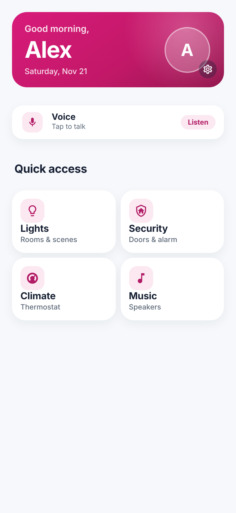
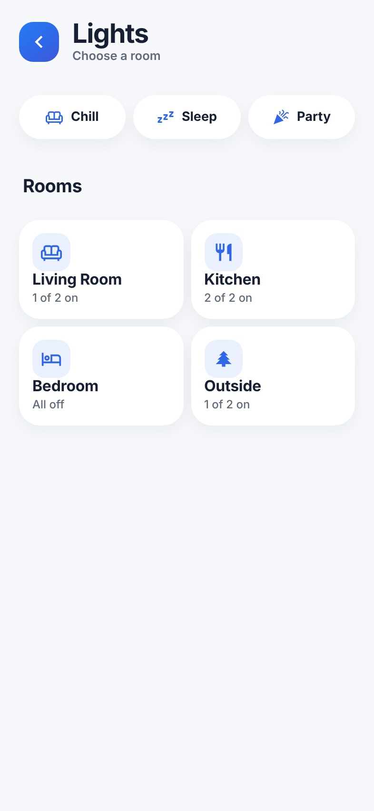
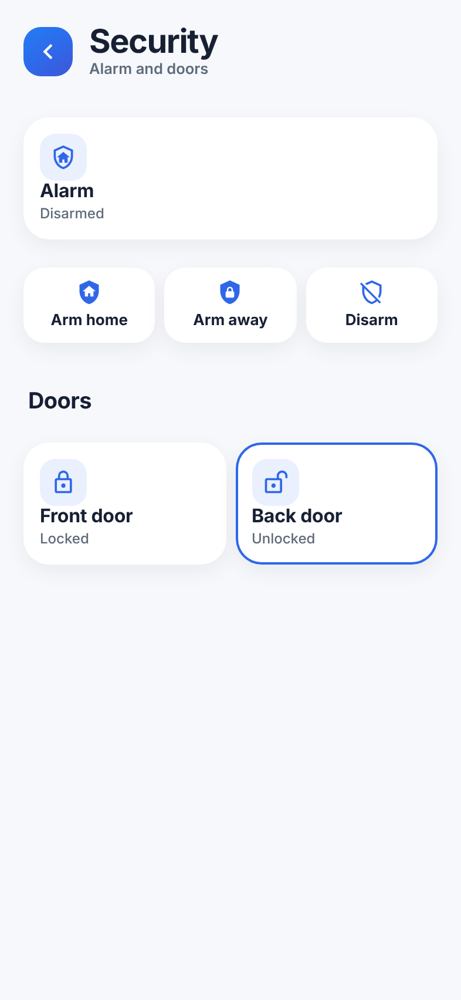

# Daylight Home

A clean, light mobile dashboard for Home Assistant. It has white rounded tiles on a soft gray page and a gradient hero card. The hero accent is picked per user: blue by default and rose for the users you list. Kiosk Mode hides the HA header.

| Home (blue) | Home (rose) | Lights |
|---|---|---|
|  |  |  |

| Room | Security | Climate |
|---|---|---|
|  |  |  |

Screenshots come from a test instance with demo entities and a fake user, "Alex".

## Views

- **Home**:
  - hero with greeting, first name, date, an initials avatar and a gear button
  - voice bar that opens Assist
  - quick-access tiles for Lights, Security, Climate and Music
- **Lights**:
  - Chill / Sleep / Party scene chips
  - room tiles for Living Room, Kitchen, Bedroom and Outside, each showing how many lights are on
  - **Room subviews**: All on / All off, plus Mushroom light cards with brightness
- **Security**: alarm status, Arm home / Arm away / Disarm, and front and back door locks
- **Climate**: thermostat with HVAC mode buttons
- **Music**: two Mushroom media player cards

## Files

| File | What it is |
|---|---|
| `dashboard.yaml` | the dashboard (paste into the raw configuration editor) |
| `themes/daylight.yaml` | the light theme |
| `tools/contrast.py` | WCAG contrast check for the palette |
| `docs/` | screenshots |
| `SETUP.md` | install steps and the placeholder table |

## Quick start

1. Install button-card, Mushroom, card-mod, layout-card and Kiosk Mode from HACS.
2. Add `themes/daylight.yaml` to your themes folder.
3. Create a dashboard at `/daylight-home` and paste `dashboard.yaml` into the raw configuration editor.
4. Replace the placeholder entity IDs.

Full steps are in [SETUP.md](SETUP.md).

## License

MIT. See [LICENSE](LICENSE).
