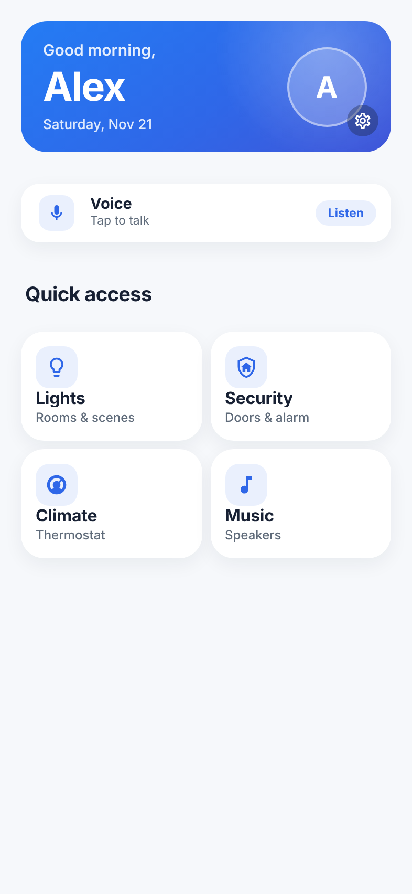
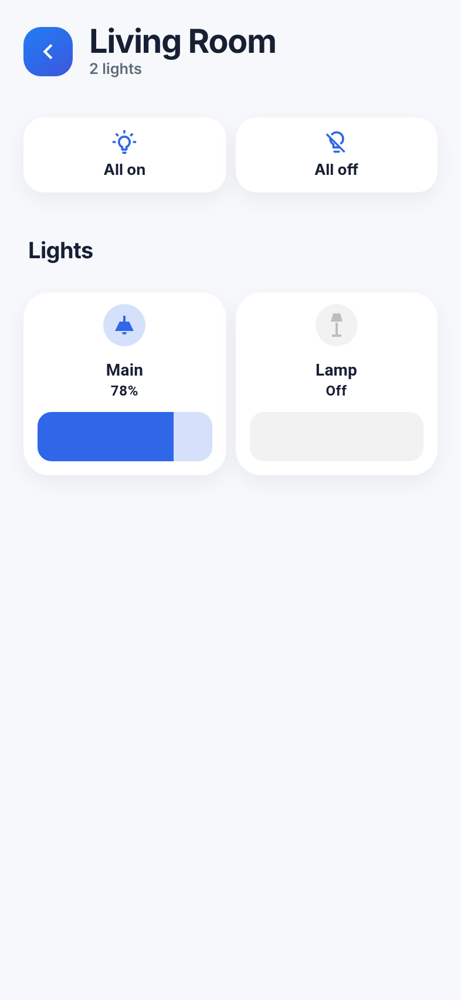
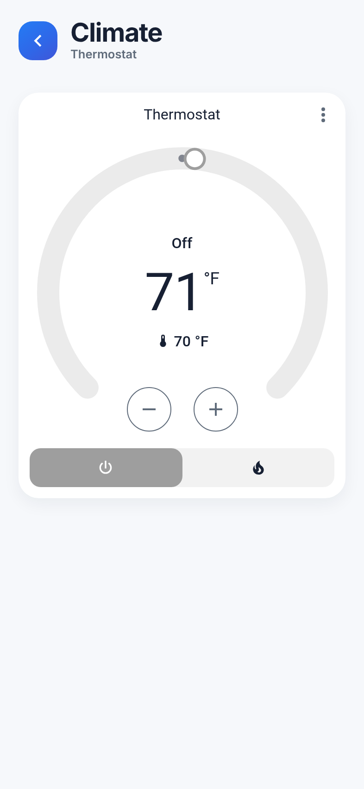
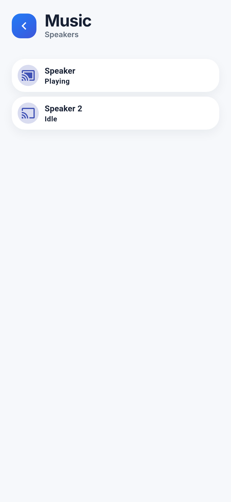

# Daylight Home

A clean, light Home Assistant dashboard that feels like a native phone app.

## Why Daylight Home?

When you’re heading to bed, open Lights to see which rooms still have lights on. Tap a room to dim one lamp or turn everything in that room off, or choose the Sleep scene from the Lights view. Daylight Home puts those everyday controls within a thumb’s reach in the Companion app or on a portrait kiosk tablet. You bring the devices and scenes. The layout, cards, and light theme come with the template.

## A look around

The screenshots use demo devices and a fictional user on a test instance. Select any image to see it at full size.

| Home in rose | Lights | Living Room |
| --- | --- | --- |
|  |  |  |

| Security | Climate | Music |
| --- | --- | --- |
|  |  |  |

- **Home.** A time-of-day greeting, the date, and your initials sit above the Assist voice bar. Four fixed-size tiles open Lights, Security, Climate, and Music. The accent is blue by default, with rose available per user.
- **Lights.** Pick Chill, Sleep, or Party, or see how many lights are on in the Living Room, Kitchen, Bedroom, and Outside. Each room has All on and All off controls plus individual Mushroom brightness sliders.
- **Security.** Check the alarm state, arm home or away, disarm, and see whether each door is locked. **Once you connect real entities, the alarm buttons send real commands. Tapping a door tile toggles that lock.** Hold a tile to open its details.
- **Climate and music.** Set the temperature and choose an HVAC mode on the built-in thermostat card. Two Mushroom media player cards handle speaker volume and playback.
- **Theme and navigation.** Kiosk Mode hides the standard navigation on mobile. The light theme uses white tiles against a soft gray background. The [contrast check](tools/contrast.py) tests normal text, large text, and icons against their respective WCAG thresholds.

## Requirements

You’ll need Home Assistant, [HACS](https://hacs.xyz/), and the five frontend extensions below. The template was tested on Home Assistant **2026.11.2** with demo entities on a test instance. Physical-phone and other-version testing is still pending.

| Install through HACS | What it does here |
| --- | --- |
| [button-card](https://github.com/custom-cards/button-card) | Greeting, room tiles, scene chips, and navigation |
| [Mushroom](https://github.com/piitaya/lovelace-mushroom) | Room brightness sliders and speaker controls |
| [card-mod](https://github.com/thomasloven/lovelace-card-mod) | Card styles and spacing |
| [layout-card](https://github.com/thomasloven/lovelace-layout-card) | Grid layout for portrait screens |
| [Kiosk Mode](https://github.com/NemesisRE/kiosk-mode) | Hide standard navigation on mobile |

## Quickstart

1. **Install the five HACS extensions** and refresh your browser or Companion app.
2. **Load the theme.** Copy [daylight.yaml](themes/daylight.yaml) into `/config/themes/`. Enable that directory in your Home Assistant frontend configuration, then restart Home Assistant or run `frontend.reload_themes`. The [theme setup](SETUP.md#2-theme) includes the YAML.
3. **Create a dashboard** in **Settings → Dashboards** with the URL `daylight-home`. If you choose a different URL, replace the `/daylight-home/` paths in the dashboard YAML.
4. **Connect your entities.** In a copy of [dashboard.yaml](dashboard.yaml), replace the 17 placeholder IDs for lights, scenes, alarm, locks, thermostat, and speakers. The [placeholder table](SETUP.md#4-replace-the-placeholders) lists each one.
5. **Open the dashboard’s Raw configuration editor**, paste your edited YAML, and save. Open `/daylight-home/home`, tap **Lights**, and check a room’s entities before trying its controls.

The [full setup guide](SETUP.md) includes the tested card versions and installation details.

## Make it yours

- **Rooms and devices.** When you add or rename a light, update the room’s `lights` list **and** its subview cards. The list calculates the count on the Lights screen. Check the targets of the room’s All on and All off actions as well.
- **Blue or rose.** In `dashboard.yaml`, find `button_card_templates → dh_base → variables → rose_users`. Replace the example value with the Home Assistant display names that should use rose, separated by a vertical bar (`|`). Everyone else gets blue.
- **Colors.** Edit [the Daylight theme](themes/daylight.yaml) for the page and standard card colors. The greeting gradients and per-user accents are in [the dashboard YAML](dashboard.yaml). After changing the theme, reload themes. If you change the palette, update the color pairs in [the contrast script](tools/contrast.py) and run `python3 tools/contrast.py`.

## FAQ

**How do I get out of Kiosk Mode?** Tap the gear on the home screen, or open `/daylight-home/home?disable_km`. Hold the gear to go directly to Settings.

**Why does a tile say “Custom element doesn’t exist”?** Check that its extension is installed in HACS and loaded as a dashboard resource. Refresh the browser or clear the Companion app’s frontend cache after installation.

**Why hasn’t the theme changed?** Every view selects `daylight`. Check the file location and the frontend themes include in `configuration.yaml`, then reload themes. If you just enabled themes for the first time, restart Home Assistant. [Theme setup](SETUP.md#2-theme)

**What does the voice bar need?** It opens Home Assistant Assist. Set up a working Assist pipeline on your instance and allow microphone access in the app or browser for spoken requests.

## Credits and license

Daylight Home is free to use and adapt under the [MIT License](LICENSE). Thanks to the maintainers of button-card, Mushroom, card-mod, layout-card, and Kiosk Mode. Those extensions are distributed separately under their own licenses.

Daylight Home is an independent community project with no affiliation with Home Assistant, the Open Home Foundation, or the extension authors.
